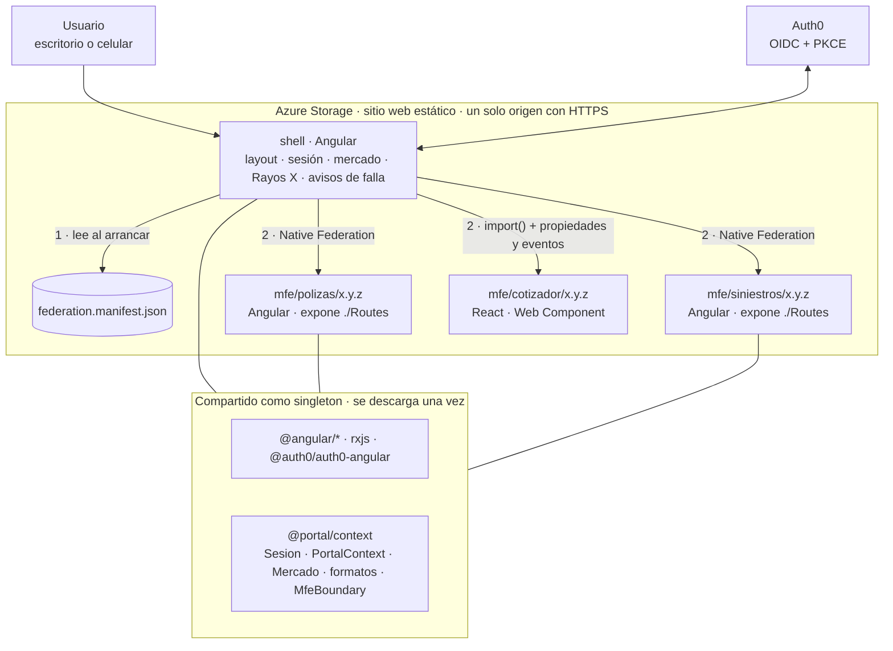

# Portal de asegurados · PoC de micro frontends

Prueba de concepto de una arquitectura de **micro frontends** para un portal de autoservicio de seguros: un **shell en Angular 22** compone en tiempo de ejecución tres micro frontends que se compilan y publican por separado, **dos en Angular y uno en React**, con login único, estado compartido, tropicalización por país, diseño responsivo, resiliencia ante fallas y publicación independiente por versiones en **Azure**.

**Autor:** Carlos Ignacio Andrade Torres · Octubre de 2026

> **La hipótesis que valida esta PoC:** con Angular 22 y Native Federation es posible que varios dominios de negocio se desarrollen y **publiquen por separado** sin perder una experiencia única, una sesión única ni la estabilidad del portal. El costo agregado frente a una aplicación Angular modular es medible, y solo se justifica **si existe la necesidad organizacional** de liberar por separado.

---

## Demo en vivo

| Acceso | URL |
|---|---|
| Con inicio de sesión (Auth0) | https://caportalmfepoc.z19.web.core.windows.net/ |
| Respaldo con sesión simulada | https://caportalmfepoc.z19.web.core.windows.net/?sesion=simulada |

Los códigos QR de ambas direcciones están en [`docs/presentacion/`](docs/presentacion/).

**Qué probar:**

1. Inicia sesión y recorre **Pólizas**, **Siniestros** y **Cotizador**.
2. Enciende **Rayos X**: cada parte de la pantalla muestra a qué micro frontend pertenece, su versión, su tecnología y su origen.
3. En Pólizas elige una **póliza activa** y presiona **Reportar siniestro**: Siniestros la recibe sin que la escribas.
4. Cambia el **país**: cambian el catálogo, los formatos, las reglas fiscales y los dominios disponibles.
5. En el **Cotizador** (React), cotiza: el shell (Angular) recibe y muestra el resultado.
6. Ábrelo en el **celular**.

---

## Arquitectura



### Aplicaciones

| Aplicación | Tecnología | Responsabilidad | Expone | Desarrollo | Demo local | Azure |
|---|---|---|---|---|---|---|
| `shell` | Angular 22 | Layout, menú, sesión, selector de país, Rayos X, avisos de falla, carga de micro frontends | — (host dinámico) | `:4200` | `:8080` | `/` |
| `mfe-polizas` | Angular 22 | Catálogo de pólizas por mercado y selección de la póliza activa | `./Routes` | `:4201` | `:8081` | `/mfe/polizas/x.y.z/` |
| `mfe-siniestros` | Angular 22 | Reporte de siniestros con validación fiscal por país | `./Routes` | `:4202` | `:8082` | `/mfe/siniestros/x.y.z/` |
| `mfe-cotizador` | React + Vite | Cotización de seguros por mercado | `<mfe-cotizador>` | `:4203` | `:8083` | `/mfe/cotizador/x.y.z/` |
| `portal-context` | Librería Angular | Contratos y servicios compartidos | `@portal/context` | — | — | — |

### Cómo arranca el portal

1. `main.ts` del shell descarga `federation.manifest.json`.
2. Descarta las entradas cuyo **origen no está en la lista de permitidos**.
3. Separa las entradas: las que terminan en `remoteEntry.json` van a **Native Federation**; las demás son **Web Components** que se cargan con `import()`.
4. Inicializa la federación y arranca Angular.
5. Cada dominio se descarga **solo cuando el usuario navega a él**, después de pasar los guards de sesión y de mercado.

### Comunicación entre micro frontends

| Mecanismo | Para qué | Ejemplo |
|---|---|---|
| **Contexto compartido con signals** | Estado que varios dominios leen | Póliza activa, mercado, Rayos X |
| **URL** | Navegación entre dominios | Pólizas → `/siniestros` |
| **Propiedades y eventos del navegador** | Integración con otros frameworks | Shell → `contexto` → Cotizador; Cotizador → `cotizacion-generada` → shell |

**Prohibido:** importar código de otro micro frontend, o un store global sin dueño. Solo se comparte lo que más de un dominio necesita; lo demás es privado de cada dominio (por ejemplo, los reportes de siniestro viven solo en `mfe-siniestros`).

---

## Stack

| Pieza | Versión |
|---|---|
| Angular, Angular CLI | 22.2.3 |
| TypeScript | 6.0.3 |
| Node.js | 24 LTS (24.15 o mayor) |
| npm | 11 |
| Native Federation (`@angular-architects/native-federation`) | 22.2.x (v4) |
| SDK de Auth0 (`@auth0/auth0-angular`) | 2.x |
| React + Vite (Cotizador) | Plantilla `react-ts` de Vite 8 |
| Playwright | Con el Microsoft Edge instalado en el equipo |
| Hosting | Azure Storage, sitio web estático (Standard, LRS, Hot) |

---

## Estructura del repositorio

```text
portal-mfe/
├── projects/
│   ├── shell/                  # Host dinámico (Angular)
│   ├── mfe-polizas/            # Remote (Angular)
│   ├── mfe-siniestros/         # Remote (Angular)
│   ├── mfe-cotizador/          # Web Component (React + Vite), con su propio package.json
│   └── portal-context/         # Librería compartida: @portal/context
├── scripts/
│   ├── apps.mjs                # Cómo se construye cada micro frontend
│   ├── publicar.mjs            # Publica en el hosting local versionado
│   ├── revertir.mjs            # Rollback local (solo cambia el manifiesto)
│   ├── azure.mjs               # Operaciones contra Azure Storage
│   ├── publicar-azure.mjs      # Publica en Azure
│   └── revertir-azure.mjs      # Rollback en Azure
├── e2e/portal.spec.ts          # Pruebas de Playwright
├── docs/
│   ├── adr/                    # Decisiones de arquitectura
│   ├── guia-rapida.md          # Para qué sirve cada archivo, módulo por módulo
│   └── presentacion/           # Códigos QR y guion de la demo
├── hosting/                    # (ignorado) hosting local generado por los scripts
└── playwright.config.ts
```

---

## Primeros pasos

### Requisitos

- Node.js 24 LTS y npm 11.
- Angular CLI 22: `npm install -g @angular/cli@22`.
- Microsoft Edge (lo usan las pruebas).
- Para publicar en Azure: Azure CLI y acceso a la suscripción.

### Instalación

```bash
git clone https://github.com/pluzeidon/portal-mfe.git
cd portal-mfe
npm install
npm --prefix projects/mfe-cotizador install
```

En Windows con PowerShell, si npm está bloqueado: `Set-ExecutionPolicy -Scope CurrentUser RemoteSigned`.

### Desarrollo

```bash
npm run dev
```

Levanta las cuatro aplicaciones en una sola terminal. Abre http://localhost:4200.

Cada micro frontend también funciona **aislado**, para que su equipo desarrolle sin levantar el portal: `localhost:4201`, `localhost:4202`, y `npm --prefix projects/mfe-cotizador run dev` para el Cotizador.

---

## Comandos

| Comando | Qué hace |
|---|---|
| `npm run dev` | Las cuatro aplicaciones en modo desarrollo |
| `npm run e2e` | Pruebas end-to-end en escritorio y celular |
| `npm run e2e:reporte` | Abre el reporte visual de las pruebas |
| `npm run publicar <app> <versión>` | Compila **solo esa aplicación** y la publica en `hosting/` |
| `npm run revertir <app> <versión>` | Activa una versión ya publicada cambiando solo el manifiesto |
| `npm run demo` | Sirve el hosting local en los puertos 8080 a 8083 |
| `npm run demo:base` + `npm run servir:siniestros` | Igual, con Siniestros en otra terminal para apagarlo en la demo de resiliencia |
| `npm run publicar:azure <app> <versión>` | Compila y publica en Azure Storage |
| `npm run revertir:azure <app> <versión>` | Rollback en Azure |

`<app>` puede ser `shell`, `polizas`, `siniestros` o `cotizador`.

---

## Sesión

El shell decide la implementación de la sesión; los micro frontends solo dependen de la abstracción `Sesion` de `@portal/context` y no saben qué proveedor hay detrás.

| Modo | Cómo se activa | Para qué |
|---|---|---|
| **Auth0** (predeterminado) | URL normal | Login real con OIDC y PKCE |
| **Simulada** | Agregar `?sesion=simulada` a la URL | Pruebas automáticas y respaldo de la demo |

El modo se guarda en `sessionStorage` mientras la pestaña esté abierta; `?sesion=auth0` regresa al modo normal. La configuración vive en `projects/shell/src/app/configuracion.ts`.

---

## Tropicalización

El país **no convierte importes**: define cuatro cosas. La moneda es un dato de cada póliza.

| | México | Colombia | España |
|---|---|---|---|
| **Formato** (`Intl`) | `es-MX` | `es-CO` | `es-ES` |
| **Documento fiscal** | RFC | Cédula o NIT | NIF o NIE |
| **Dominios disponibles** | Pólizas, Siniestros, Cotizador | Pólizas, Siniestros | Pólizas, Cotizador |
| **Catálogo** | Incluye una póliza de vida en USD | Pesos colombianos | Euros |

Los formatos usan la API estándar `Intl` del navegador, la misma en Angular y en React. Detalles en el [ADR 0006](docs/adr/0006-tropicalizacion-por-mercado.md).

---

## Publicación y versiones

Cada micro frontend se publica en una **carpeta versionada e inmutable**, y el **manifiesto** decide qué versión usa el portal.

```text
npm run publicar:azure polizas 1.1.0     # compila solo Pólizas y la sube a /mfe/polizas/1.1.0/
npm run revertir:azure polizas 1.0.0     # rollback: solo cambia una línea del manifiesto
```

| Parte | ¿Real o simulada? |
|---|---|
| Compilación de producción de cada aplicación por separado | Real |
| Versiones inmutables en carpetas | Real |
| Manifiesto como único punto de control de versiones | Real |
| Publicación en la nube con HTTPS (Azure) | Real |
| Pipeline de CI/CD | **Simulado**: los scripts se ejecutan a mano |

---

## Pruebas

```bash
npm run e2e
```

Cinco pruebas, cada una en **escritorio** (Edge) y **celular** (Pixel 7 emulado): 10 ejecuciones.

| Prueba | Qué valida |
|---|---|
| Póliza → siniestro | Estado compartido y navegación entre dominios |
| Cambio de país | Catálogo, formato, reglas fiscales y dominios por mercado |
| Siniestros no responde | El portal muestra un aviso y lo demás sigue funcionando |
| Cotizador en React | El contrato entre shell y Web Component, en las dos direcciones |
| Ninguna pantalla se desborda | Gobierno del diseño responsivo |

Con micro frontends, los errores de integración ya no los detecta el compilador sino el runtime; por eso las pruebas recorren **la composición real**, no cada aplicación por separado.

---

## Seguridad

| Tema | En la PoC | En producción |
|---|---|---|
| Código remoto | Lista de orígenes permitidos en el shell | + Content Security Policy y Subresource Integrity |
| Guards de rutas | Solo controlan la navegación | **La autorización real la hace el backend** |
| Tokens | En `localStorage`, para sobrevivir al recargar | Patrón BFF en ASP.NET Core: sin tokens en el navegador |
| Domain y Client ID de Auth0 | En el código: en una SPA no son secretos | Igual, más dominio personalizado de login |
| Publicación en Azure | Clave de la cuenta de Storage, desde la CLI | Identidad administrada con rol *Storage Blob Data Contributor* |
| Modo de sesión simulada | Activable por URL | Excluido del build de producción |

---

## Problemas conocidos y decisiones de compatibilidad

| Situación | Causa | Solución aplicada |
|---|---|---|
| `invalid path mapping` al arrancar un remote | La librería apuntaba a `dist/`, que no existe sin compilarla | `@portal/context` apunta a su código fuente en `tsconfig.json` |
| `Could not resolve "@angular/animations/browser"` | Angular 22 ya no instala `@angular/animations` y Native Federation comparte todos los entry points | Se agregaron las animaciones a `skip` en los tres `federation.config.mjs` |
| `rootDir` obligatorio en la librería | TypeScript 6 dejó de inferirlo | `"rootDir": "./src"` en `tsconfig.lib.json` |
| Advertencias de *install-scripts* | Protección nueva de npm 11 | Paquetes de compilación aprobados en `package.json` |
| Textos congelados o mal traducidos en Chrome | `lang="en"` hacía que el navegador tradujera la página por debajo de Angular | `lang="es"` en todos los `index.html` |
| Ejemplos de internet con `shareAll` y `loadRemoteModule` importado | Son de Native Federation v3 | Se usa la API v4: `fromPackageJson` y el `loadRemoteModule` del resultado de `initFederation` |
| El Cotizador usa `vite build --watch` en desarrollo | El servidor de desarrollo de Vite inyecta recarga en caliente que no funciona dentro de otra página | Se sirve el archivo compilado; al cambiar React hay que recargar el navegador |

---

## Mediciones

> **Pendiente:** se completan con la salida de `npm run publicar` de cada aplicación.

| Aplicación | Tecnología | Tamaño inicial | Transferencia estimada (comprimido) | Tiempo de compilación |
|---|---|---|---|---|
| shell | Angular | | | |
| polizas | Angular | | | |
| siniestros | Angular | | | |
| cotizador | React | 302.87 kB | 78.56 kB (gzip) | |

**Lectura:** Pólizas y Siniestros comparten Angular con el shell, así que su código propio es pequeño. El Cotizador trae **su propio React** porque no se comparte con nadie: ese es el costo medible de introducir otro framework.

---

## Cuándo sí y cuándo no usar micro frontends

| Señal | Micro frontends | Aplicación modular con lazy loading |
|---|---|---|
| Equipos de front | 3 o más, con dominios distintos | 1 o 2 |
| Liberaciones | Cada dominio a su ritmo | Un release conjunto es aceptable |
| Fronteras de dominio | Claras y estables | Difusas o cambiantes |
| Código legado | Convivencia larga con lo existente | Migración de una vez |
| Tipo de portal | Interno o autenticado | Público, sensible a cada KB |

**Postura:** empezar modular y extraer a micro frontend solo el dominio que tenga una razón concreta: otro equipo, otra cadencia de liberación o una migración.

---

## Fuera de alcance (siguientes pasos)

1. Monorepo con **Nx** y límites de módulo verificados en CI.
2. **Pipelines de CI/CD** por micro frontend con identidad administrada.
3. **Backend en ASP.NET Core** con autorización real y patrón **BFF**.
4. **Content Security Policy** e **integridad de subrecursos (SRI)**.
5. **Telemetría** por micro frontend (Application Insights u OpenTelemetry).
6. Política de caché por tipo de archivo y **CDN** (Azure Front Door).
7. Contrato del Cotizador como **paquete de tipos compartido**, en lugar de dos copias.
8. Design system como librería formal, SSR e internacionalización de textos.

---

## Decisiones de arquitectura

Ver [`docs/adr/`](docs/adr/README.md).

## Referencias

- [Micro Frontends with Angular, Module Federation, and Auth0](https://auth0.com/blog/micro-frontends-with-angular-module-federation-and-auth0/), Manfred Steyer, Auth0, 2022. Ejemplo de referencia.
- [Micro Frontends with Angular and Native Federation](https://blog.angular.dev/micro-frontends-with-angular-and-native-federation-7623cfc5f413), blog oficial de Angular, 2025.
- [Native Federation v4 para Angular](https://github.com/native-federation/angular-adapter) y su [documentación de runtime](https://native-federation.com/docs/v4/angular-adapter/runtime/).
- [Compatibilidad de versiones de Angular](https://angular.dev/reference/versions).
