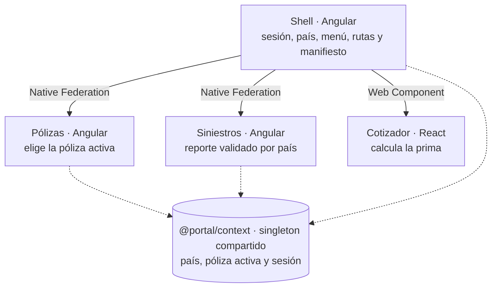

# Guía rápida del portal: módulos y archivos

El portal son cinco módulos en un solo repositorio: un shell, tres micro frontends y una librería compartida. Cada sección trae el árbol de un módulo con una línea por archivo, para responder en segundos «¿para qué sirve este archivo?».

| Módulo | Qué es | Tecnología | Puerto en desarrollo / hosting local |
| --- | --- | --- | --- |
| `shell` | El anfitrión: encabezado, menú, sesión, país y rutas; carga a los demás | Angular 22 | 4200 / 8080 |
| `portal-context` | Librería compartida: estado, contratos, sesión, formato y Rayos X | Angular (librería) | No corre sola |
| `mfe-polizas` | Dominio Pólizas: consulta y elección de la póliza activa | Angular 22 | 4201 / 8081 |
| `mfe-siniestros` | Dominio Siniestros: reporte con validación por país | Angular 22 | 4202 / 8082 |
| `mfe-cotizador` | Dominio Cotizador: cálculo de prima, integrado como Web Component | React 19 + Vite | 4203 / 8083 |



Las flechas salen solo del shell: él carga a cada dominio. Entre dominios no hay flechas; se coordinan por la librería compartida. React no usa la librería: recibe el contexto por una propiedad y responde con un evento.

## Raíz del repositorio

La raíz reúne lo que comparten todas las aplicaciones: un solo `package.json`, la configuración de compilación, las pruebas E2E y los scripts de publicación.

```
portal-mfe/
├─ package.json          Dependencias de TODO el portal y comandos (dev, demo, publicar, e2e)
├─ angular.json          Cómo se compila y sirve cada proyecto Angular (puertos, builder de federación)
├─ tsconfig.json         Reglas de TypeScript y el alias @portal/context → código fuente
├─ playwright.config.ts  Pruebas E2E: Edge, escritorio y Pixel 7; levanta los 4 servidores
├─ e2e/
│  └─ portal.spec.ts     Los 5 escenarios E2E (× 2 dispositivos = 10 pruebas)
├─ scripts/
│  ├─ apps.mjs           Cómo se construye cada app y dónde escribe su versión
│  ├─ publicar.mjs       Publica una versión en hosting/ local; se niega a sobrescribir
│  ├─ revertir.mjs       Apunta el manifiesto local a otra versión; no compila nada
│  ├─ azure.mjs          Utilidades de Azure CLI: subir carpetas, leer y subir el manifiesto
│  ├─ publicar-azure.mjs Lo mismo que publicar.mjs, pero en Azure Storage
│  └─ revertir-azure.mjs Lo mismo que revertir.mjs, pero en Azure Storage
├─ docs/
│  ├─ adr/               Las 10 decisiones de arquitectura (ADRs)
│  ├─ guia-rapida.md     Este documento
│  └─ presentacion/      Códigos QR del portal en Azure y guion de la demo
├─ README.md             Qué es, cómo se arranca, cómo se publica
└─ projects/             Los 5 módulos (secciones siguientes)
```

`hosting/`, `dist/`, `test-results/` y `playwright-report/` se generan al compilar o probar y no se suben a Git.

## shell

El shell es el anfitrión: arranca primero, decide qué código entra, es dueño de lo transversal (sesión, país, menú) y monta a los demás en sus rutas.

```
shell/
├─ federation.config.mjs     Qué se comparte como singleton (Angular, RxJS, @portal/*); no expone nada
├─ public/
│  └─ federation.manifest.json  Directorio de remotes: nombre → URL (en dev apunta a 4201–4203)
└─ src/
   ├─ index.html              Página base: lang="es", <app-root>
   ├─ main.ts                 Lee el manifiesto, filtra orígenes permitidos, initFederation, luego Angular
   ├─ bootstrap.ts            Arranca Angular con el resultado de la federación
   ├─ styles.css              Tokens de diseño, punto de quiebre 40rem, tabla responsiva
   └─ app/
      ├─ app.config.ts        El «Program.cs»: router, federación, Web Components y sesión
      ├─ configuracion.ts     Tenant de Auth0 y modo de sesión (?sesion=simulada)
      ├─ app.routes.ts        Rutas: inicio, remotes con guards y carga diferida, cotizador
      ├─ app.ts / app.html    Encabezado: menú ☰, país, póliza activa, sesión y Rayos X
      ├─ app.css              Encabezado para celular primero; escritorio desde 40rem
      ├─ inicio.ts            Pantalla de inicio: saludo y tarjetas de dominios del país
      ├─ dominios.ts          Catálogo de dominios: nombre, ruta, título, descripción
      ├─ sesion.guard.ts      Exige sesión; si no hay, manda a iniciar sesión con URL de regreso
      ├─ dominio.guard.ts     Bloquea un dominio que no existe en el país actual
      ├─ shell-info.ts        Nombre, versión y origen del shell (para Rayos X)
      ├─ app.spec.ts          Prueba unitaria generada por Angular (rota; pendiente)
      └─ federation/
         ├─ cargar-remoto.ts         Descarga un remote con límite de 5 s; si falla, rutas de respaldo
         ├─ remoto-no-disponible.ts  Aviso «X no está disponible» con Reintentar e Ir al inicio
         ├─ componentes-web.ts       Mapa de Web Components y su carga con límite de tiempo
         ├─ contrato-cotizador.ts    Contrato v1 con React: qué entra y qué sale
         └─ cotizador-host.ts        Anfitrión del cotizador: le pasa el contexto y escucha su evento
```

Si preguntan «¿dónde se decide…?»: qué código entra → `main.ts`; qué sesión se usa → `app.config.ts`; quién puede entrar a un dominio → los dos guards; qué pasa si un remote falla → `cargar-remoto.ts`.

## portal-context

La librería compartida es el contrato de la plataforma: se descarga una sola vez (singleton) y todos los módulos Angular la importan como `@portal/context`. React no la usa.

```
portal-context/
├─ ng-package.json        Entrada para publicarla como paquete npm (hoy no se usa en el día a día)
├─ package.json           Nombre y versión de la librería (0.0.1)
└─ src/
   ├─ public-api.ts        El «mostrador»: lo único que los equipos pueden importar
   └─ lib/
      ├─ mercado.ts         Manual por país: locale, documento fiscal y dominios. Sin moneda
      ├─ poliza.ts          Formato de la póliza que viaja entre dominios; la moneda vive aquí
      ├─ portal-context.ts  Pizarrón compartido con signals: país, póliza activa, Rayos X
      ├─ sesion.ts          Contrato de identidad (clase abstracta Sesion) y Usuario mínimo
      ├─ sesion-simulada.ts Fake de sesión: modo aislado, pruebas E2E y respaldo de la demo
      ├─ sesion-auth0.ts    Adaptador de Auth0: PKCE, refresh tokens, perfil → Usuario
      ├─ formato.ts         Pipes importe y fechaLocal con Intl (sin trampa de zona horaria)
      └─ mfe-boundary.ts    La «cinta de obra» de Rayos X: nombre · versión · tecnología · origen
```

Por qué todos ven el mismo país: la librería se comparte como singleton en `federation.config.mjs` (`sharedMappings`) y los remotes se montan bajo el inyector del shell. Mismo código y mismo inyector dan la misma instancia.

## mfe-polizas

Pólizas es un remote Angular que expone solo sus rutas (`./Routes`). Muestra el catálogo del país y es el único que escribe la póliza activa en el contexto compartido.

```
mfe-polizas/
├─ federation.config.mjs   name: 'polizas'; expone './Routes'; mismos compartidos que el shell
└─ src/
   ├─ main.ts               initFederation sin remotes → luego Angular (para correr solo)
   ├─ bootstrap.ts          Arranca la app en modo aislado
   ├─ index.html            Página del modo aislado («Pólizas · modo aislado»)
   └─ app/
      ├─ polizas.routes.ts  LO QUE SE EXPONE: POLIZAS_ROUTES (PolizasRaiz → PolizasLista)
      ├─ polizas-raiz.ts    Envuelve todo en <mfe-boundary> para Rayos X
      ├─ polizas-lista.ts   Tabla responsiva; «Usar como póliza activa» y «Reportar siniestro»
      ├─ polizas.data.ts    Pólizas de ejemplo por país (MX, CO, ES), cada una con su moneda
      ├─ mfe-info.ts        Nombre, versión y origen real (import.meta.url); el script reescribe la versión
      ├─ app.config.ts      Solo para el modo aislado: router + sesión simulada
      ├─ app.routes.ts      Solo para el modo aislado: reutiliza POLIZAS_ROUTES
      └─ app.ts / app.html  Componente raíz del modo aislado (<router-outlet />)
```

Dentro del portal solo se usan `polizas.routes.ts` y lo que cuelga de él; `main.ts`, `bootstrap.ts`, `app.*` e `index.html` existen para que el equipo trabaje sin levantar el shell.

## mfe-siniestros

Siniestros es un remote Angular con la misma estructura que Pólizas. Lee la póliza activa del contexto y cambia la validación del documento fiscal según el país.

```
mfe-siniestros/
├─ federation.config.mjs    name: 'siniestros'; expone './Routes'
└─ src/
   ├─ main.ts / bootstrap.ts / index.html   Arranque del modo aislado (igual que Pólizas)
   └─ app/
      ├─ siniestros.routes.ts  LO QUE SE EXPONE: SINIESTROS_ROUTES (SiniestrosRaiz → SiniestrosReporte)
      ├─ siniestros-raiz.ts    Envuelve todo en <mfe-boundary> para Rayos X
      ├─ siniestros-reporte.ts Formulario reactivo: RFC / Cédula o NIT / NIF o NIE, fecha y descripción;
      │                        un effect cambia el validador al cambiar de país; folio SIN-xxxxxx
      ├─ reportes.store.ts     Lista de reportes enviados (signal), propia del dominio
      ├─ mfe-info.ts           Nombre, versión y origen real para Rayos X
      └─ app.config.ts / app.routes.ts / app.ts / app.html   Solo para el modo aislado
```

Ejemplo de regla de arquitectura: los reportes viven en `reportes.store.ts`, dentro de Siniestros, y no en el contexto compartido. Solo va a `@portal/context` lo que usan dos o más dominios.

## mfe-cotizador

El cotizador es React 19 compilado con Vite como un solo archivo, `mfe-cotizador.js`, que registra el Web Component `<mfe-cotizador>`. No usa Native Federation ni conoce Angular: recibe el contexto por una propiedad y responde con un evento.

```
mfe-cotizador/
├─ package.json         Dependencias propias: React y Vite (separadas del package.json de Angular)
├─ vite.config.ts       Compila en modo librería: un solo módulo ES, mfe-cotizador.js
├─ index.html           Página del modo aislado («Cotizador · modo aislado»)
├─ eslint.config.js     Reglas de calidad de código para React
└─ src/
   ├─ mfe-cotizador.tsx  El Web Component: Shadow DOM, propiedad contexto (entrada),
   │                     evento cotizacion-generada (salida); exporta INFO
   ├─ Cotizador.tsx      La pantalla en React: producto, suma asegurada, cálculo y resultado
   ├─ tarifas.ts         Tarifas e impuestos ficticios por país (MXN, COP, EUR)
   ├─ contrato.ts        Contrato v1 con el shell; copia idéntica de contrato-cotizador.ts
   ├─ info.ts            Nombre y versión que muestra Rayos X
   └─ demo.ts            Solo para el modo aislado: le pasa un contexto de prueba
```

Peso medido: 302.87 kB sin comprimir y 78.56 kB comprimidos, porque React viaja dentro del archivo y no se comparte. Es el costo de la excepción tecnológica, documentada en el [ADR 0008](adr/0008-micro-frontend-en-react.md).

## Respuestas de bolsillo: ¿dónde se decide…?

| Pregunta | Archivo | Respuesta corta |
| --- | --- | --- |
| ¿Qué código puede entrar al portal? | `shell/src/main.ts` | Solo orígenes de la lista permitida, compilada en el shell |
| ¿Dónde viven los remotes? | `federation.manifest.json` | Se lee al arrancar; publicar o revertir = cambiar una línea |
| ¿Qué se comparte y qué no? | `federation.config.mjs` | Angular, RxJS, Auth0 y `@portal/*` como singleton; lo demás es privado |
| ¿Por qué Angular se carga una sola vez? | `main.ts` + `bootstrap.ts` | Primero se negocia la federación; después se importa Angular |
| ¿Auth0 o sesión simulada? | `shell/src/app/app.config.ts` | Una línea elige el instalador; nadie más lo sabe |
| ¿Quién puede entrar a un dominio? | `sesion.guard.ts`, `dominio.guard.ts` | Hay que tener sesión y el dominio debe existir en el país |
| ¿Qué pasa si un remote falla? | `cargar-remoto.ts` | Límite de 5 s y rutas de respaldo con el aviso |
| ¿Cómo se comparte el país? | `portal-context.ts` | Un signal en el pizarrón compartido; todos leen el mismo |
| ¿Qué cambia por país? | `mercado.ts` | Formato, documento fiscal, catálogo y dominios; la moneda no |
| ¿Cómo habla React con Angular? | `cotizador-host.ts`, `mfe-cotizador.tsx` | Propiedad `contexto` hacia React, evento `cotizacion-generada` hacia el shell |
| ¿Cómo se ve bien en celular? | `shell/src/styles.css` | Un solo punto de quiebre (40rem), tabla como tarjetas, controles de 44 px |
| ¿Cómo se publica una versión? | `scripts/publicar*.mjs` | Carpeta por versión, nunca se sobrescribe; actualiza el manifiesto |
| ¿Cómo se revierte? | `scripts/revertir*.mjs` | Solo apunta el manifiesto a la versión anterior |
| ¿Cómo sé que todo funciona junto? | `e2e/portal.spec.ts` | 10 pruebas E2E: flujo, país, caída, React y desbordes |
